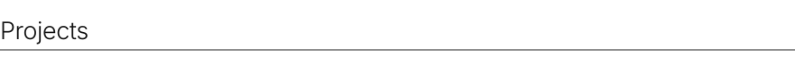
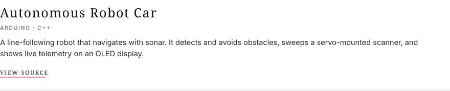
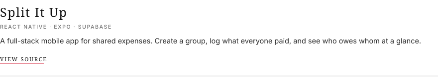
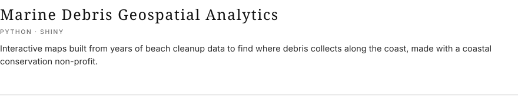
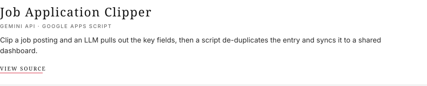

<picture>
  <source media="(prefers-color-scheme: dark)" srcset="./assets/header-dark.svg">
  
</picture>

<picture><source media="(prefers-color-scheme: dark)" srcset="./assets/subtitle-dark.svg"></picture>&nbsp;&nbsp;<a href="https://www.linkedin.com/in/raner-chow-b31522329"><picture><source media="(prefers-color-scheme: dark)" srcset="./assets/link-linkedin-dark.svg"></picture></a>&nbsp;&nbsp;<a href="mailto:raner.chow@snhu.edu"><picture><source media="(prefers-color-scheme: dark)" srcset="./assets/link-email-dark.svg"></picture></a>

  

<picture>
  <source media="(prefers-color-scheme: dark)" srcset="./assets/h-about-dark.svg">
  
</picture>

<picture>
  <source media="(prefers-color-scheme: dark)" srcset="./assets/about-dark.svg">
  
</picture>

  

<picture>
  <source media="(prefers-color-scheme: dark)" srcset="./assets/h-stack-dark.svg">
  
</picture>

<picture>
  <source media="(prefers-color-scheme: dark)" srcset="./assets/stack-dark.svg">
  
</picture>

  

<picture>
  <source media="(prefers-color-scheme: dark)" srcset="./assets/h-projects-dark.svg">
  
</picture>

<a href="REPO_LINK"><picture><source media="(prefers-color-scheme: dark)" srcset="./assets/p-robot-dark.svg"></picture></a>

<a href="https://github.com/3lenavan/Split-It-Up"><picture><source media="(prefers-color-scheme: dark)" srcset="./assets/p-splititup-dark.svg"></picture></a>

<picture>
  <source media="(prefers-color-scheme: dark)" srcset="./assets/p-marine-dark.svg">
  
</picture>

<a href="CLIPPER_LINK"><picture><source media="(prefers-color-scheme: dark)" srcset="./assets/p-clipper-dark.svg"></picture></a>

  

<picture>
  <source media="(prefers-color-scheme: dark)" srcset="./assets/footer-dark.svg">
  
</picture>
